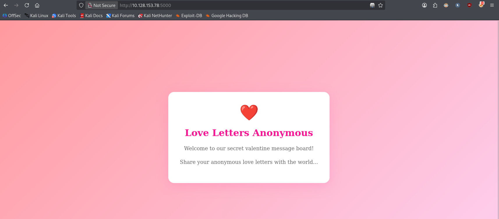
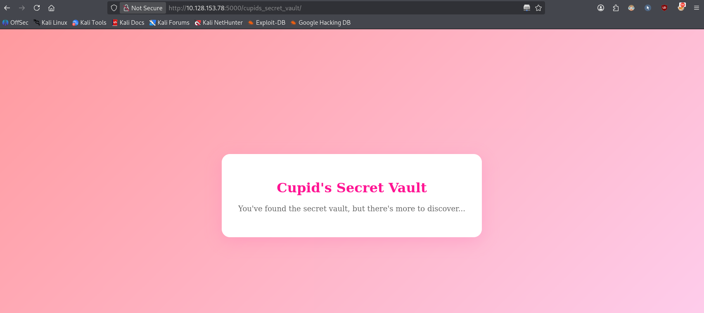
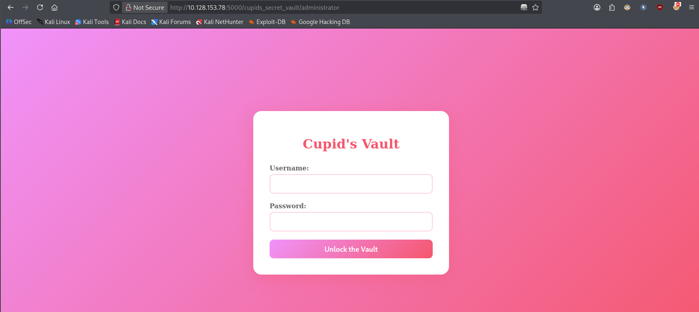
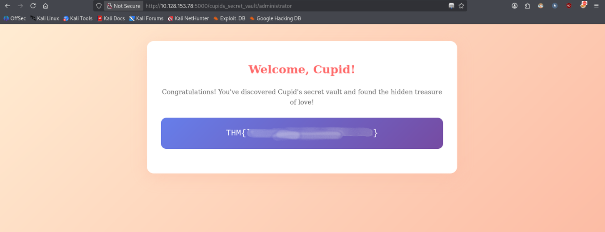

# Hidden Deep Into my Heart


> Cupid's Vault was designed to protect secrets meant to stay hidden forever. Unfortunately, Cupid underestimated how determined attackers can be.

**Task:** find what's hidden deep inside the website.

**Room link:** https://tryhackme.com/room/lafb2026e9

---

## 1. Verify the machine is running

```bash
ping -c 3 10.128.153.78
```

- `-c 3` sends 3 ICMP echo requests and then stops (without it, `ping` runs forever until you `Ctrl+C`).

```
PING 10.128.153.78 (10.128.153.78) 56(84) bytes of data.
64 bytes from 10.128.153.78: icmp_seq=1 ttl=62 time=17.3 ms
64 bytes from 10.128.153.78: icmp_seq=2 ttl=62 time=14.8 ms
64 bytes from 10.128.153.78: icmp_seq=3 ttl=62 time=14.1 ms

--- 10.128.153.78 ping statistics ---
3 packets transmitted, 3 received, 0% packet loss, time 2003ms
rtt min/avg/max/mdev = 14.099/15.372/17.250/1.355 ms
```

The machine is up.

## 2. Scanning for open ports

```bash
nmap -sC -sV -v 10.128.153.78
```

- `-sC` runs Nmap's default NSE script set (banner grabs, common misconfig checks, etc.).
- `-sV` probes open ports to determine the service/version running on them.
- `-v` increases verbosity so progress is printed as the scan runs.

```
PORT     STATE SERVICE VERSION
22/tcp   open  ssh     OpenSSH 8.9p1 Ubuntu 3ubuntu0.10 (Ubuntu Linux; protocol 2.0)
| ssh-hostkey:
|   256 0c:e0:81:36:5a:7b:79:ed:df:bb:e7:b8:40:41:23:a6 (ECDSA)
|_  256 a9:ae:66:8f:be:f1:5a:34:e4:d4:f1:c8:c1:48:ed:04 (ED25519)
5000/tcp open  http    Werkzeug httpd 3.1.5 (Python 3.10.12)
| http-methods:
|_  Supported Methods: GET OPTIONS HEAD
| http-robots.txt: 1 disallowed entry
|_/cupids_secret_vault/*
|_http-title: Love Letters Anonymous
|_http-server-header: Werkzeug/3.1.5 Python/3.10.12
Service Info: OS: Linux; CPE: cpe:/o:linux:linux_kernel
```

Two open ports: SSH (22) and a Flask/Werkzeug dev server on port 5000. Nmap's `http-robots.txt` script already flagged something interesting on its own: a `robots.txt` entry disallowing `/cupids_secret_vault/*`. That's a strong hint that something is being hidden there, so it's worth checking manually later.

## 3. Inspecting the web application



The homepage ("Love Letters Anonymous") doesn't show anything useful, and the page source doesn't contain any hints, hidden comments, or links either. Time to enumerate.

## 4. Directory/file enumeration with ffuf

```bash
ffuf -u "http://10.128.153.78:5000//FUZZ" \
     -w /home/verykraken/GitClones/SecLists/Discovery/Web-Content/combined_directories.txt:FUZZ \
     -ic -c
```

- `-u` the target URL, with `FUZZ` marking where the wordlist entries get substituted.
- `-w wordlist:FUZZ` the wordlist to use, bound to the `FUZZ` keyword (useful when fuzzing more than one position at once).
- `-ic` ("ignore comments") skips lines in the wordlist starting with `#`, so comment lines in the wordlist aren't sent as requests.
- `-c` colorizes the output for readability.

Only `robots.txt` came back as a valid result:

```
robots.txt              [Status: 200, Size: 70, Words: 4, Lines: 5, Duration: 18ms]
:: Progress: [128628/128628] :: Job [1/1] :: 803 req/sec :: Duration: [0:02:46] :: Errors: 1 ::
```

> Note the double `/` before `FUZZ` in the URL (`...5000//FUZZ`). That wasn't a typo here — it was deliberate, to fuzz straight off the web root. Nmap's matcher list (`200-299,301,302,307,401,403,405,500`, ffuf's default) only shows "interesting" status codes, which is why only `robots.txt` is visible even though 128,628 requests were sent.

## 5. robots.txt leaks the hidden path (and a password)

```bash
curl http://10.128.153.78:5000/robots.txt
```

```
User-agent: *
Disallow: /cupids_secret_vault/*

# cupid_arrow_2026!!!
```

`robots.txt` is meant to tell search engine crawlers which paths *not* to index — it's not an access-control mechanism, and the file itself is always publicly readable. Here it backfires twice:

1. The `Disallow` entry itself hands us the exact hidden path (`/cupids_secret_vault/*`) that Nmap had already flagged.
2. Someone left a commented-out string that looks exactly like a password: `cupid_arrow_2026!!!`. Worth remembering for later.

Let's visit the directory:

```
http://10.128.153.78:5000/cupids_secret_vault/
```



Again, nothing in the rendered page or its source. Time to fuzz this directory specifically.

## 6. Enumerating the hidden directory

```bash
ffuf -u "http://10.128.153.78:5000/cupids_secret_vault/FUZZ" \
     -w /home/verykraken/GitClones/SecLists/Discovery/Web-Content/combined_directories.txt:FUZZ \
     -ic -c
```

Same flags as before, this time scoped to `/cupids_secret_vault/`. This time we get a hit:

```
administrator           [Status: 200, Size: 2381, Words: 956, Lines: 90, Duration: 43ms]
```



An unlinked, un-indexed admin login page — found purely through brute-forcing the directory name, since nothing on the site pointed to it.

## 7. Logging in

At this point we have:
- A likely password, leaked in a `robots.txt` comment: `cupid_arrow_2026!!!`
- No username, but this is flagged as an easy box, so it's worth trying the obvious default (`admin`) before reaching for a brute-forcer like Hydra.

```
Username: admin
Password: cupid_arrow_2026!!!
```

It works on the first try, and the flag is revealed behind the login.



Room solved.

## Takeaways

This box chains two very common, very avoidable mistakes:

1. **Information disclosure via `robots.txt`.** `robots.txt` is a convention for crawlers, not a security boundary — the file is public by design. Listing a sensitive path in `Disallow` tells an attacker exactly where to look (the "don't look here" sign is itself a map), and leaving a credential in a comment inside that same public file is effectively publishing it.
2. **Security through obscurity for the admin panel.** The `/cupids_secret_vault/administrator` page had no authentication rate-limiting and relied entirely on not being linked from anywhere — once directory brute-forcing (`ffuf`) found it, the only remaining barrier was a guessable username (`admin`) and a password that had already leaked.

**Could this have been avoided?**

- Never put real paths or credentials in `robots.txt` (or any other publicly served file); use it only for genuinely non-sensitive crawler hints, and rely on proper server-side authentication/authorization — not a crawler directive — to actually restrict access.
- Treat "unlinked" as equivalent to "public." Any path reachable over HTTP will eventually be found by directory brute-forcing; hidden admin panels still need real authentication, account lockout/rate-limiting, and ideally should sit behind a VPN, IP allow-list, or additional auth factor rather than depending on nobody finding the URL.
- Avoid predictable usernames like `admin` paired with reused/hardcoded passwords. Enforce strong, unique credentials and consider MFA for any administrative interface.
- Rotate any credential that was ever committed to a config file, comment, or public asset — once a secret has been exposed anywhere (even "temporarily" in a comment), it should be treated as compromised.